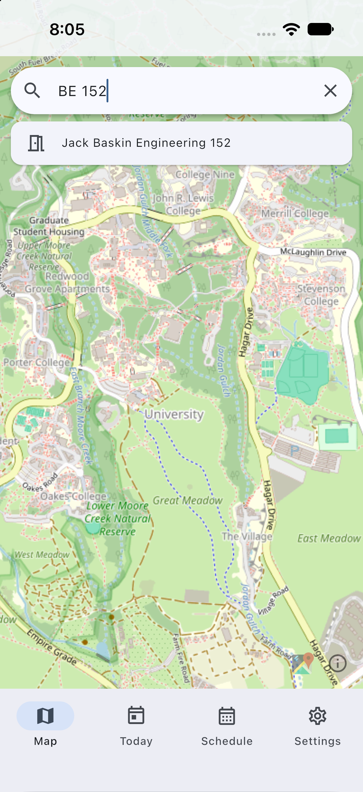
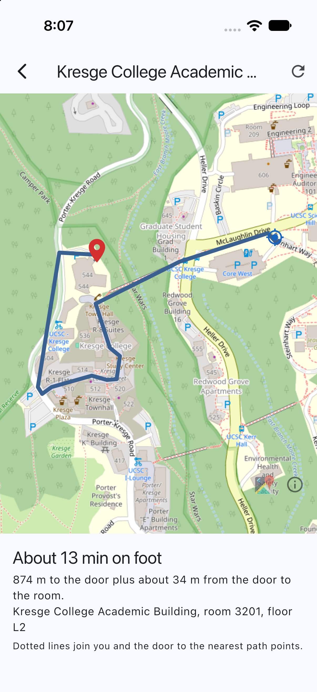
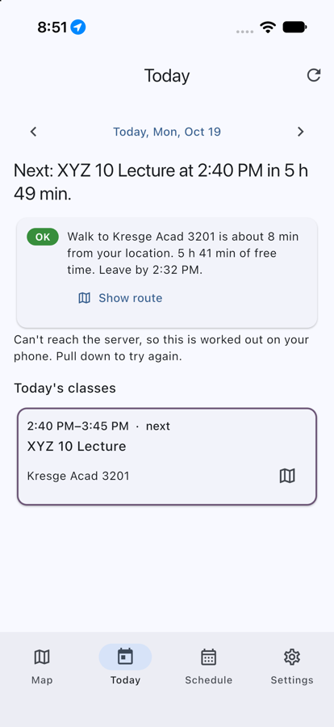
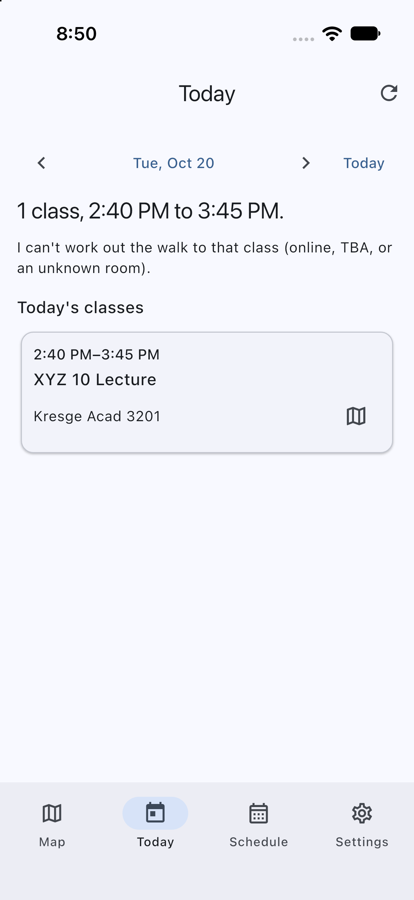

# UCSC Campus Router

Find any UC Santa Cruz classroom, see it on a map, and get walking directions to it, even when Apple and Google Maps don't know the room.

Many UCSC classrooms (Baskin Engineering, Thimann Labs, and more) don't appear in the big map apps, so students end up searching campus maps online. This project keeps its own campus dataset and its own routing engine (written in C), and puts them behind a small server and a Flutter app. You can use the parts separately:

- **Map**: search a room or building ("BE 152", "kresge 3201", "Thimann 101"), see where it is, get a route. No schedule or sign-up needed.
- **Today**: import your class schedule and see what's now and next, how long the walk is, whether you have time, and when to leave. Works offline from saved walk times.
- **Schedule**: paste your MyUCSC schedule, import a calendar (`.ics`) file, or add classes by hand. It stays on your phone.

| Map search | Route | Today, offline | Day picker |
|---|---|---|---|
|  |  |  |  |

_Captured in the iOS Simulator (iPhone 17) with the simulator's location set to campus; not a real device. Map tiles are OpenStreetMap's public ones because no tile key was set._ More in [docs/screenshots](docs/screenshots).

## Status

As of October 2026. The routing engine, server, data pipeline and Android/iOS app code are working and tested (hundreds of automated tests across C, Python and Dart, run in CI). The app is covered by widget tests and by integration tests that run in the iOS Simulator ([how](docs/developer-notes.md#simulator-checks)). It has **not been run on a physical device**, so real GPS accuracy and notification timing are unverified, and notifications were not exercised in the simulator either. Photo import (screenshot to schedule) is experimental and unverified against real input, see [developer notes](docs/developer-notes.md#photo-import).

| Area | State |
|---|---|
| Room and building search | Working: abbreviations, partial names, typos (`/api/search`) |
| Routing | Working: real walking paths from OpenStreetMap, elevation-aware effort, optional avoid-stairs. Straight-line distance inside buildings; floors are shown but not routed |
| Today, schedule import, reminders, day picker | Working. Reminders cover every class left today and are planned when the app opens |
| Offline | Today works offline; search, map and routes need the server |
| Data | 32 buildings and the 87 general-assignment classrooms. Other rooms resolve to their building's nearest door |
| Not built | Week view, saved places, campus shuttle/bus, a map overlay of buildings and doors |

## How it works

```
OpenStreetMap ──► data-pipeline/ (Python) ──► graph/ucsc/{nodes,edges}.csv  (+ USGS elevation)
                                                      │
UCSC classroom directory + campus map ──► data/       ▼
                                          engine/ (C11): Dijkstra and A*, grade-aware costs
                                                      │
                                                      ▼
                          server/ (Python, standard library) ──► app/ (Flutter, iOS + Android)
                                                              └─► web/ (Leaflet demo)
```

| Directory | What it is |
|---|---|
| `engine/` | The router in C11: compressed-sparse-row graph, min-heap, Dijkstra and A*, tests under AddressSanitizer. |
| `server/` | Small HTTP server over the engine: search, routing, schedule parsing, the "today" logic. Keeps nothing about students. |
| `app/` | The Flutter app (`ucsc_router`, Riverpod). See [app/README.md](app/README.md). |
| `data-pipeline/`, `graph/`, `data/` | How the campus graph and building/room data are built, and the committed results. |
| `web/` | A browser demo that shows Dijkstra and A* side by side. |
| `docs/` | [Developer notes](docs/developer-notes.md), [hosting](docs/hosting.md). |
| `REVIEW.md` | An honest review of the project's weaknesses and the fixes made. |

## Run it (macOS)

You need Xcode (for iOS), [Flutter](https://docs.flutter.dev/get-started/install/macos), a C compiler with `make` (comes with Xcode's command line tools), and Python 3.12 or newer.

**1. The app, against the hosted server** (nothing else to set up):

```bash
cd app
flutter pub get
open -a Simulator
flutter run
```

**2. Or your own server**, for working on the engine or data:

```bash
make -C engine route               # build the router
python3 server/server.py           # http://127.0.0.1:8000, also serves the web demo
cd app && flutter run --dart-define=SERVER_URL=http://127.0.0.1:8000
```

The iOS simulator reaches a plain-`http` server on `127.0.0.1`, `localhost`, a LAN address or a `.local` name without any App Transport Security exception (checked in the simulator; the app's network calls use `dart:io`, which ATS does not govern). The hosted `https` server passes Apple's default ATS check (`nscurl --ats-diagnostics`). A physical phone is untested: it will ask for local-network access the first time it reaches a LAN server. The Android emulator uses `http://10.0.2.2:8000`. Details, hosted map tiles and the offline design are in [app/README.md](app/README.md).

**3. Tests**

```bash
make -C engine test                          # C engine, under AddressSanitizer and UBSan
python3 -m unittest discover -s server       # server, against the real engine
python3 -m unittest discover -s data-pipeline/tests
cd app && flutter analyze && flutter test
```

The data tests run without the heavy geospatial packages. Rebuilding the graph or buildings needs `pip install -r data-pipeline/requirements.txt` and the network, see the [developer notes](docs/developer-notes.md#regenerating-the-graph).

## Privacy

Your schedule is saved only on your phone. When the app needs a walk time it sends the schedule text and your location to the server, which uses them for that one answer and does not store them or log locations. A server you don't run can still see those requests, so point the app at a server you trust. Search, routing and the map need the network.

## License

The code is released under the [MIT License](LICENSE). The data below keeps its own terms and is not covered by that license.

## Data sources

| Data | Source | Status |
|---|---|---|
| Elevation of each graph node | [USGS 3DEP](https://www.usgs.gov/3d-elevation-program) 10 m data (`ned10m`) through the [OpenTopoData](https://www.opentopodata.org/) API, fetched once by `data-pipeline/fetch_elevation.py` and committed in `graph/ucsc/nodes.csv` | USGS data is public domain. |
| Walking network and building footprints/entrances | [OpenStreetMap](https://www.openstreetmap.org/copyright) via osmnx, committed in `graph/ucsc/` and `data/buildings.json` | © OpenStreetMap contributors, [ODbL](https://opendatacommons.org/licenses/odbl/). Derived data must keep this attribution. |
| Classroom names ("AIS Display Name") and facility ids | The public [UCSC classroom directory](https://classrooms.ucsc.edu/), read by `data-pipeline/fetch_classrooms.py` and committed as `data/classrooms.json` | Public web pages. No license or reuse terms were found or checked; this project is not affiliated with or endorsed by UCSC. |
| Room coordinates and floor levels | The public classroom-points layer behind the [UCSC campus map](https://maps.ucsc.edu/) (UCSC Planning, Design & Construction), also in `data/classrooms.json` | Same as above: public, read-only, terms not checked. |
| Hand-edited names, aliases and term dates | `data/building_sources.json`, `data/search_aliases.json`, `data/holidays.json` | Written for this project. Check term dates against the official UCSC academic calendar. |

If you are a UCSC data owner and want something changed or removed, open an issue.
