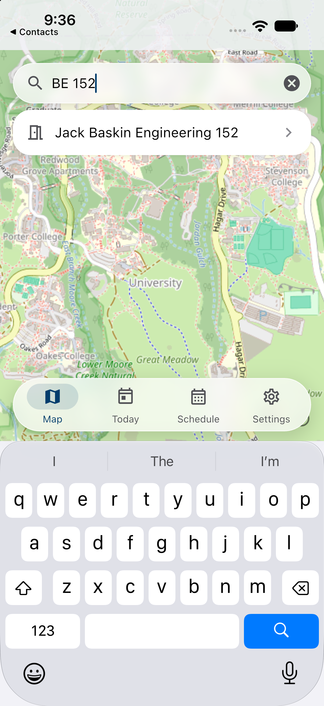
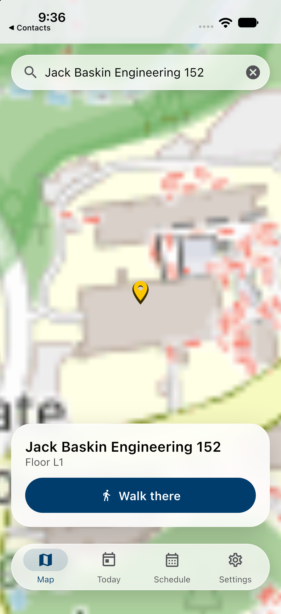
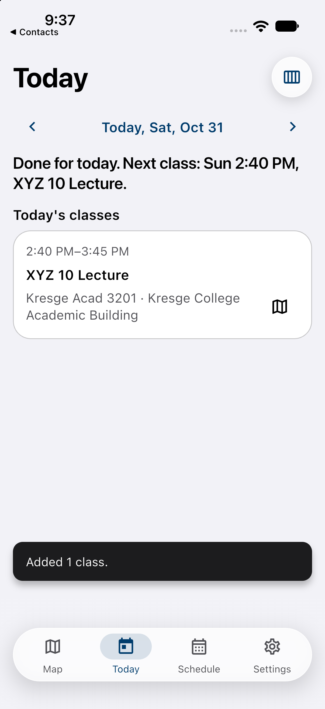
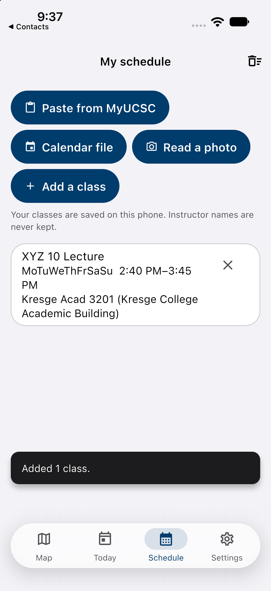
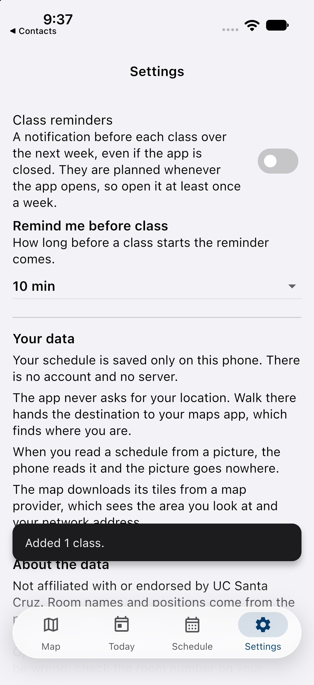
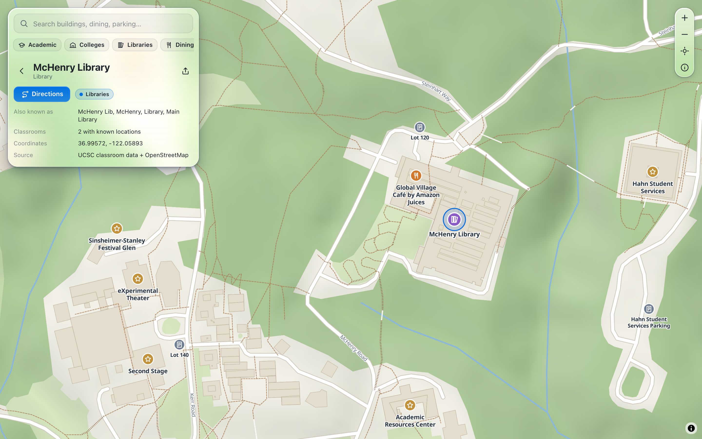
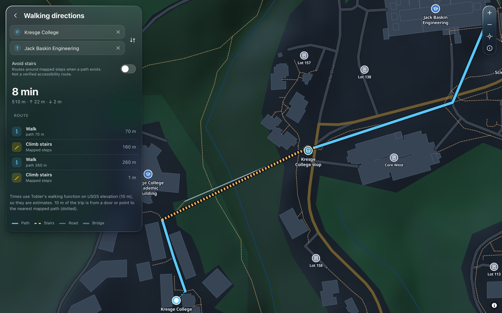
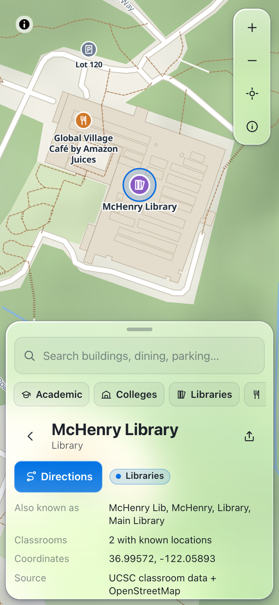

# Classmap

[](https://github.com/JMBugarin/ucsc-campus-router-v2/actions/workflows/ci.yml)

**Your UC Santa Cruz class schedule on an interactive campus map.** Open it to see what you have today, at what time, and exactly where each room is, including rooms Apple and Google Maps don't know (Baskin Engineering, Thimann Labs and more). **Walk there** hands the destination to your own maps app, which does the directions.

The app keeps no server and no account. Everything runs on the phone.

| Map search | Place card | Today | Schedule | Settings |
|---|---|---|---|---|
|  |  |  |  |  |

_Captured on 2026-10-31 in the iOS Simulator (iPhone 17) with an invented schedule; not a real device._

## Campus map on the web

[`web/`](web/README.md) is a separate, installable web map of campus built on free, open-source parts (MapLibre, OpenFreeMap, OpenStreetMap): search, place pages, walking routes over the campus path network, and a glass interface ported from TileLens. It needs no key, account or server. See [docs/web-app.md](docs/web-app.md).

| Place | Route (dark) | Mobile |
|---|---|---|
|  |  |  |

## What it does

- **Today**: the classes of the day with their times, rooms and buildings, the break between them, and what is on now and next. Step to any other day, or open the week.
- **Map**: search a room or building ("BE 152", "kresge 3201", "thimann 101"; typos and abbreviations are fine). Today's classes are pinned. No schedule needed.
- **Walk there**: opens walking directions to the room's door in Apple Maps (Google Maps on Android). The app gives it only the destination; your maps app finds where you are.
- **Schedule**: paste your MyUCSC class schedule, import a calendar (`.ics`) file, read a screenshot or photo of it (iOS, on the phone, with Apple's Vision framework), or add a class by hand. You can skip a single day, and it stays on your phone.
- **Class reminders**: an optional notification a few minutes before each class over the next week.

See [status](docs/status.md) for what is verified and what is not.

## What it does not do

It does not plan routes, show bus times, or know where you are. Use Apple Maps, Google Maps or Transit to get to campus; this app tells you where on campus to go.

## Run it (macOS)

You need [Flutter](https://docs.flutter.dev/get-started/install/macos) and, for iOS, Xcode.

```bash
cd app
flutter pub get
open -a Simulator
flutter run
```

Tests and checks:

```bash
cd app
flutter analyze
flutter test                                              # unit and widget tests
flutter test integration_test/app_test.dart -d <simulator> # the whole app on a simulator
python3 -m unittest discover -s ../data-pipeline/tests     # the data tools
```

## How it is built

| Directory | What it is |
|---|---|
| `app/` | The Flutter app (`classmap`, Riverpod). Campus search, schedule parsing, calendar import and day logic are plain Dart in `lib/campus`, `lib/features/schedule/import` and `lib/features/today`. See [app/README.md](app/README.md). |
| `data/` | The campus data the app ships: 32 hand-checked buildings with their doors, 53 more teaching buildings from the campus map (outline centre, no door), the 87 general-assignment classrooms, search aliases, term dates and holidays. Copied into `app/assets/data` by `scripts/sync_app_data.sh`; a test fails if they differ. |
| `data-pipeline/`, `graph/` | The tools that built the data from public sources, and the OpenStreetMap walking graph they use to place doors. Run rarely. |
| `docs/` | [Status](docs/status.md), [developer notes](docs/developer-notes.md), [data sources](docs/data-sources.md), [photo import](docs/photo-import.md). |

The search, schedule reader and calendar reader were ported from Python. `app/test/fixtures/golden_port.json` holds the Python outputs they are tested against.

## Data and credit

Room names and positions come from UCSC's public classroom directory and campus map; building outlines and doors are © OpenStreetMap contributors ([ODbL](https://opendatacommons.org/licenses/odbl/)). Map tiles come from a tile provider that sees the area you look at. This project is not affiliated with or endorsed by UC Santa Cruz. See [data sources](docs/data-sources.md) for terms and what has and has not been checked.

## License

The code is [MIT](LICENSE). The data keeps its own terms.
