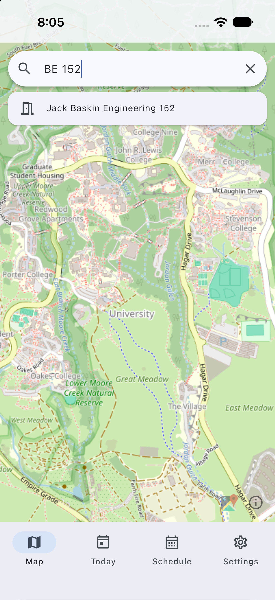
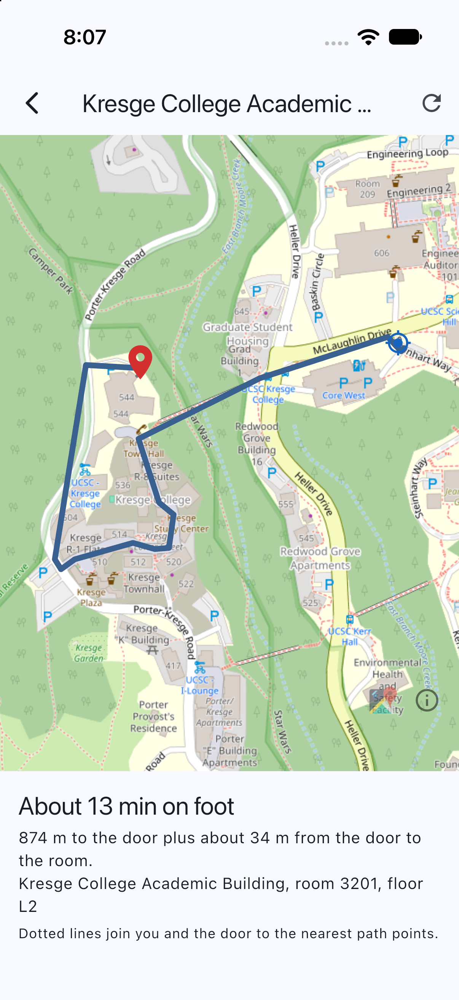
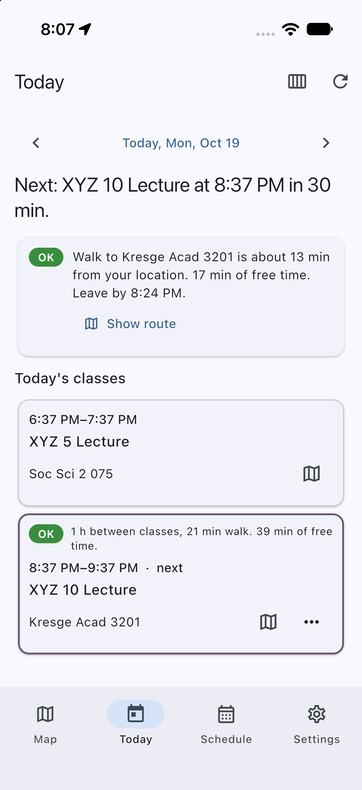
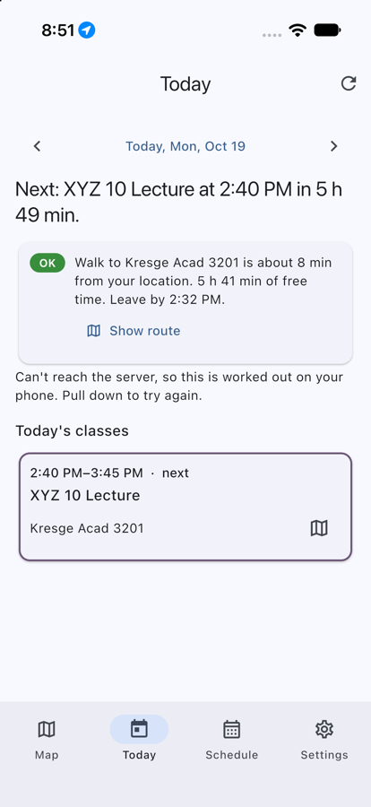
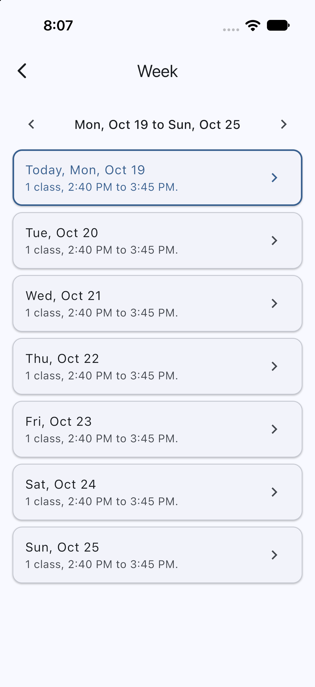

# UCSC Campus Router

[](https://github.com/JMBugarin/ucsc-campus-router-v2/actions/workflows/ci.yml)
   

**Walking directions to any UC Santa Cruz classroom, including rooms Apple and Google Maps don't know.** A from-scratch stack: a C routing engine, a Python server and a Flutter app that turns your class schedule into "when to leave".

| Map search | Route | Today | Offline | Week view |
|---|---|---|---|---|
|  |  |  |  |  |

_Captured on 2026-10-19 in the iOS Simulator (iPhone 17) with the simulator's location set to campus, an invented schedule and the server running on the same Mac; not a real device. Map tiles are OpenStreetMap's public ones because no tile key was set. More in [docs/screenshots](docs/screenshots)._

## Highlights

- **Own routing engine in C11.** Dijkstra and A* on a 1,960-node, 5,188-edge campus graph built from OpenStreetMap and USGS elevation (grade-aware costs). On 1,000 random queries A* explored **60% fewer nodes and ran 24% faster** than Dijkstra with **0 cost mismatches** (`make -C engine bench`).
- **Memory-safe by test.** Engine tests run under AddressSanitizer and UBSan; CI also runs Valgrind.
- **Tested across three languages.** 169 server tests and 55 data-pipeline tests (run against the real engine), C unit tests and Flutter widget tests, all in GitHub Actions (which also builds an Android debug APK), plus iOS Simulator integration tests run locally.
- **Schedule in, plan out.** Paste a MyUCSC schedule, import `.ics`, or read a screenshot on-device with Apple Vision (**141 of 142 classes correct** on invented schedules, [details](docs/photo-import.md)). Today shows the walk to the next class and when to leave, and works offline.
- **Privacy by design.** The server is stateless: no accounts, no stored schedules, no location logging (a test checks the logs).
- **Honest scope.** Not yet run on a physical phone; see [status](docs/status.md).

**Stack:** C11 · Python (standard library) · Flutter/Dart · Riverpod · Leaflet · Docker · GitHub Actions · OpenStreetMap, USGS 3DEP

## Features

- **Map**: search a room or building ("BE 152", "kresge 3201"), see it, get a route.
- **Today**: what's now and next, the walk, and when to leave. Works offline from saved walk times.
- **Schedule**: paste, `.ics`, photo (iOS) or by hand. It stays on your phone.
- **Getting to campus**: off campus, Today says when to be at a campus bus stop and hands the trip to [Transit](https://transitapp.com). See [details](docs/getting-to-campus.md).

## How it works

```
OpenStreetMap ──► data-pipeline/ (Python) ──► graph/ucsc/{nodes,edges}.csv  (+ USGS elevation)
                                                      │
UCSC classroom directory + campus map ──► data/       ▼
                                          engine/ (C11): Dijkstra and A*, grade-aware costs
                                                      │
                                                      ▼
                          server/ (Python, standard library) ──► app/ (Flutter, iOS + Android)
                                                              └─► web/ (Leaflet demo)
```

| Directory | What it is |
|---|---|
| `engine/` | The router in C11: compressed-sparse-row graph, min-heap, Dijkstra and A*, tests under AddressSanitizer. |
| `server/` | Small HTTP server over the engine: search, routing, schedule parsing, the "today" logic. Keeps nothing about students. |
| `app/` | The Flutter app (`ucsc_router`, Riverpod). See [app/README.md](app/README.md). |
| `data-pipeline/`, `graph/`, `data/` | How the campus graph and building/room data are built, and the committed results. |
| `web/` | A browser demo that shows Dijkstra and A* side by side. |
| `docs/` | [Status](docs/status.md), [developer notes](docs/developer-notes.md), [hosting](docs/hosting.md), [photo import](docs/photo-import.md), [getting to campus](docs/getting-to-campus.md), [data sources](docs/data-sources.md). |

## Run it (macOS)

You need Xcode (for iOS), [Flutter](https://docs.flutter.dev/get-started/install/macos), a C compiler with `make` (comes with Xcode's command line tools), and Python 3.12 or newer.

**1. The app, against the hosted server** (nothing else to set up):

```bash
cd app
flutter pub get
open -a Simulator
flutter run
```

**2. Or your own server**, for working on the engine or data:

```bash
make -C engine route               # build the router
python3 server/server.py           # http://127.0.0.1:8000, also serves the web demo
cd app && flutter run --dart-define=SERVER_URL=http://127.0.0.1:8000
```

The iOS simulator reaches a plain-`http` server on `127.0.0.1`, `localhost`, a LAN address or a `.local` name without any App Transport Security exception (checked in the simulator; the app's network calls use `dart:io`, which ATS does not govern). The hosted `https` server passes Apple's default ATS check (`nscurl --ats-diagnostics`). A physical phone is untested: it will ask for local-network access the first time it reaches a LAN server. The Android emulator uses `http://10.0.2.2:8000`. Details, hosted map tiles and the offline design are in [app/README.md](app/README.md).

**3. Tests**

```bash
make -C engine test                          # C engine, under AddressSanitizer and UBSan
python3 -m unittest discover -s server       # server, against the real engine
python3 -m unittest discover -s data-pipeline/tests
cd app && flutter analyze && flutter test
```

The data tests run without the heavy geospatial packages. Rebuilding the graph or buildings needs `pip install -r data-pipeline/requirements.txt` and the network, see the [developer notes](docs/developer-notes.md#regenerating-the-graph).

## Status

Engine, server, data pipeline and app code work and are tested in CI. **Not yet run on a physical device**, so real GPS accuracy and notification timing are unverified. Photo import is iOS only. Full table: [docs/status.md](docs/status.md).

## Data sources

OpenStreetMap (ODbL), USGS 3DEP elevation (public domain) and the public UCSC classroom directory and campus map (reuse terms not confirmed). Not affiliated with or endorsed by UCSC. Full table and attribution: [docs/data-sources.md](docs/data-sources.md).

## Privacy

Your schedule is saved only on your phone. When the app needs a walk time it sends the schedule text to the server and, on campus, your location; the server uses them for that one answer and does not store them or log locations. Off campus, your location stays on the phone: the server is only asked about rooms. Opening Transit or Apple Maps gives that app the campus entry point you picked, not where you are. A server you don't run can still see the requests it receives, so point the app at a server you trust. Search, routing and the map need the network. Settings spells out what is sent and to which server.

## License

The code is released under the [MIT License](LICENSE). The data below keeps its own terms and is not covered by that license.
