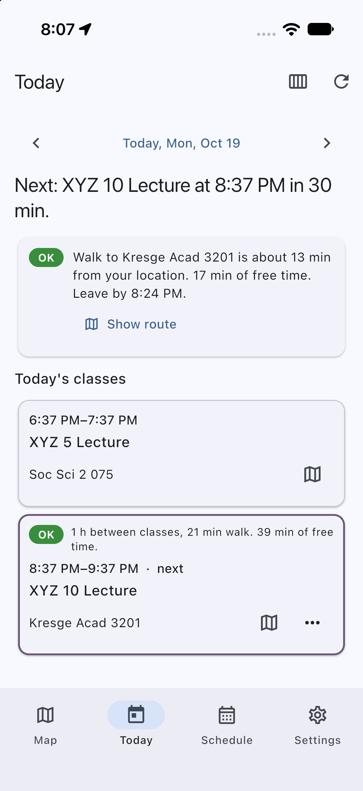
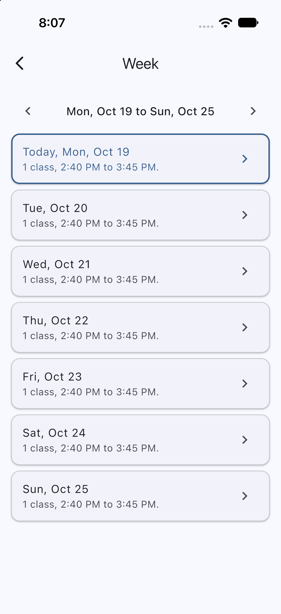
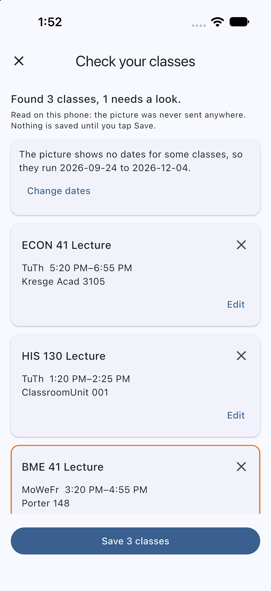
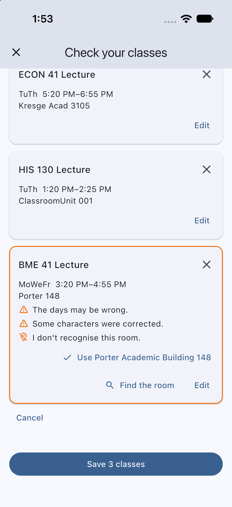

# UCSC Campus Router

Find any UC Santa Cruz classroom, see it on a map, and get walking directions to it, even when Apple and Google Maps don't know the room.

Many UCSC classrooms (Baskin Engineering, Thimann Labs, and more) don't appear in the big map apps, so students end up searching campus maps online. This project keeps its own campus dataset and its own routing engine (written in C), and puts them behind a small server and a Flutter app. You can use the parts separately:

- **Map**: search a room or building ("BE 152", "kresge 3201", "Thimann 101"), see where it is, get a route. No schedule or sign-up needed.
- **Today**: import your class schedule and see what's now and next, how long the walk is, whether you have time, and when to leave. Works offline from saved walk times.
- **Schedule**: paste your MyUCSC schedule, import a calendar (`.ics`) file, read a screenshot or photo of it (on iOS, on the phone itself: free, private, works offline, needs no account or key), or add classes by hand. It stays on your phone.

| Map search | Route | Today | Offline | Week view |
|---|---|---|---|---|
|  |  |  |  |  |

_Captured on 2026-10-19 in the iOS Simulator (iPhone 17) with the simulator's location set to campus, an invented schedule and the server running on the same Mac; not a real device. Map tiles are OpenStreetMap's public ones because no tile key was set. More in [docs/screenshots](docs/screenshots)._

## Status

As of October 2026. The routing engine, server, data pipeline and Android/iOS app code are working and tested (hundreds of automated tests across C, Python and Dart, run in CI). The app is covered by widget tests and by integration tests that run in the iOS Simulator ([how](docs/developer-notes.md#simulator-checks)). It has **not been run on a physical device**, so real GPS accuracy and notification timing are unverified, and notifications were not exercised in the simulator either. Photo import (screenshot to schedule) reads the picture on the phone and has only been tried on invented schedules in the Simulator, see [Reading a schedule from a picture](#reading-a-schedule-from-a-picture).

| Area | State |
|---|---|
| Room and building search | Working: abbreviations, partial names, typos (`/api/search`) |
| Routing | Working: real walking paths from OpenStreetMap, elevation-aware effort, optional avoid-stairs. Straight-line distance inside buildings; floors are shown but not routed |
| Today, week view, schedule import (paste, calendar file, by hand), reminders, day picker | Working. Reminders cover every class over the next week and are planned when the app opens; delivery is not verified on a device |
| Photo import | iOS only. "Read a photo" on the Schedule tab reads a screenshot or photo on the phone with Apple's Vision framework, then lists the classes for you to check before anything is saved. The picture never leaves the phone, and no account or key is involved. Measured on invented schedules in the Simulator ([results](#reading-a-schedule-from-a-picture)); not tried on a real device, a real photo or a real schedule. Not available on Android |
| Offline | Today works offline; search, map and routes need the server |
| Data | 32 buildings and the 87 general-assignment classrooms. Other rooms resolve to their building's nearest door |
| Not built | Saved places, campus shuttle/bus, a map overlay of buildings and doors |

## Reading a schedule from a picture

On iOS, **Read a photo** on the Schedule tab takes a screenshot or photo of your schedule (the MyUCSC Class Schedule page, or a phone calendar or timetable app). The phone reads it itself with Apple's Vision text recognition, and Dart code in the app turns the text into classes. It is free and needs no account or key, and the reading itself works offline. The picture never leaves the phone; afterwards only the room names it found are sent to the server, to check that it can place them, as it does for any class. (Without the server you can still choose the dates and save what was read.)

| Check your classes | A class to look at |
|---|---|
|  |  |

Nothing is saved until you tap Save on the **Check your classes** screen:

- Each class can be edited (course, type, days, times, room, dates) or removed, with Undo. Cancel throws the whole import away.
- A class the reading was not sure of is outlined and says why (`The days may be wrong`, `AM or PM was guessed`). A class that cannot be saved yet, such as one with no times, is outlined in red and Save waits.
- A room the server cannot place is marked. The room search's best match is one tap away (`Use Porter Academic Building 148`), and `Find the room` opens the full search.
- A picture that shows no dates (the card layouts tried here showed none) takes the term's dates from the server, or you choose them.

**How well it works.** Invented schedules were drawn in six layouts (MyUCSC's page at several sizes, phone-style cards in light and dark, a compact table, an export with a row for each day, cards with everything on one line, and cards that label each field), read through the app in the iOS Simulator with the real Vision framework and a local server, and the review screen was compared with what each picture says. A class counts as right only if its course, days, start, end and room text all match. Each set was 23 pictures that had not been read before:

| Layout | Set 1, before any fix | Set 2, after set 1's fixes | Set 3, final code |
|---|---|---|---|
| MyUCSC Class Schedule page | 20 of 26 | 18 of 30 | 28 of 28 |
| Phone cards | 16 of 16 | 16 of 16 | 16 of 16 |
| Compact table | 34 of 36 | 29 of 31 | 37 of 37 |
| One row for each day | 20 of 23 | 20 of 21 | 20 of 20 |
| Days, times and room on one line | 29 of 30 | 27 of 29 | 29 of 29 |
| Cards that label each field | 12 of 12 | 12 of 12 | 11 of 12 |
| **All** | **131 of 143 (92%)** | **122 of 139 (88%)** | **141 of 142 (99%)** |

Set 1's mistakes led to the first repairs and set 2's to the rest; set 3 was read once, on the final code. Every wrong class was marked for review except two in set 1, where a course number read with a letter O split one class in two. The mistakes were mostly letters misread in room names (`Clrm` read as `CIrm`), an end time the phone did not read, and table headings it misread. In set 3, 24 of the 141 right classes were marked anyway, 17 of them because the server's schedule reader did not know the way the picture wrote a room (`BE 156` where it expects `J Baskin Engr 156`); the room search finds those.

These are invented pictures in fonts and layouts the project chose, so they flatter real use: they say nothing about glare, a tilted photo of a screen, heavy compression, another app's layout or any language but English. It has not been tried on a real device, a real photo or a real schedule, and the system photo picker, a photo kept only in iCloud and a HEIC photo from the camera were not exercised. The pictures and the scripts that drew and scored them are not in the repository; the readings recorded from 22 pictures like them are, in `app/test/fixtures/ocr`, and run in CI. Reading takes about a second in the Simulator on a Mac. Android has no reader yet, so the button is not shown there.

A picture that cannot be read says so and adds nothing: one with no text, text that is not a schedule, a blurry picture, or one over 120 megapixels. A very large picture is shrunk before it is read, and a table cut off part way down gives the rows that are there; each of these was tried in the Simulator.

## How it works

```
OpenStreetMap ──► data-pipeline/ (Python) ──► graph/ucsc/{nodes,edges}.csv  (+ USGS elevation)
                                                      │
UCSC classroom directory + campus map ──► data/       ▼
                                          engine/ (C11): Dijkstra and A*, grade-aware costs
                                                      │
                                                      ▼
                          server/ (Python, standard library) ──► app/ (Flutter, iOS + Android)
                                                              └─► web/ (Leaflet demo)
```

| Directory | What it is |
|---|---|
| `engine/` | The router in C11: compressed-sparse-row graph, min-heap, Dijkstra and A*, tests under AddressSanitizer. |
| `server/` | Small HTTP server over the engine: search, routing, schedule parsing, the "today" logic. Keeps nothing about students. |
| `app/` | The Flutter app (`ucsc_router`, Riverpod). See [app/README.md](app/README.md). |
| `data-pipeline/`, `graph/`, `data/` | How the campus graph and building/room data are built, and the committed results. |
| `web/` | A browser demo that shows Dijkstra and A* side by side. |
| `docs/` | [Developer notes](docs/developer-notes.md), [hosting](docs/hosting.md). |

## Run it (macOS)

You need Xcode (for iOS), [Flutter](https://docs.flutter.dev/get-started/install/macos), a C compiler with `make` (comes with Xcode's command line tools), and Python 3.12 or newer.

**1. The app, against the hosted server** (nothing else to set up):

```bash
cd app
flutter pub get
open -a Simulator
flutter run
```

**2. Or your own server**, for working on the engine or data:

```bash
make -C engine route               # build the router
python3 server/server.py           # http://127.0.0.1:8000, also serves the web demo
cd app && flutter run --dart-define=SERVER_URL=http://127.0.0.1:8000
```

The iOS simulator reaches a plain-`http` server on `127.0.0.1`, `localhost`, a LAN address or a `.local` name without any App Transport Security exception (checked in the simulator; the app's network calls use `dart:io`, which ATS does not govern). The hosted `https` server passes Apple's default ATS check (`nscurl --ats-diagnostics`). A physical phone is untested: it will ask for local-network access the first time it reaches a LAN server. The Android emulator uses `http://10.0.2.2:8000`. Details, hosted map tiles and the offline design are in [app/README.md](app/README.md).

**3. Tests**

```bash
make -C engine test                          # C engine, under AddressSanitizer and UBSan
python3 -m unittest discover -s server       # server, against the real engine
python3 -m unittest discover -s data-pipeline/tests
cd app && flutter analyze && flutter test
```

The data tests run without the heavy geospatial packages. Rebuilding the graph or buildings needs `pip install -r data-pipeline/requirements.txt` and the network, see the [developer notes](docs/developer-notes.md#regenerating-the-graph).

## Privacy

Your schedule is saved only on your phone. When the app needs a walk time it sends the schedule text and your location to the server, which uses them for that one answer and does not store them or log locations. A server you don't run can still see those requests, so point the app at a server you trust. Search, routing and the map need the network. Settings spells out what is sent and to which server.

## License

The code is released under the [MIT License](LICENSE). The data below keeps its own terms and is not covered by that license.

## Data sources

| Data | Source | Status |
|---|---|---|
| Elevation of each graph node | [USGS 3DEP](https://www.usgs.gov/3d-elevation-program) 10 m data (`ned10m`) through the [OpenTopoData](https://www.opentopodata.org/) API, fetched once by `data-pipeline/fetch_elevation.py` and committed in `graph/ucsc/nodes.csv` | USGS data is public domain. |
| Walking network and building footprints/entrances | [OpenStreetMap](https://www.openstreetmap.org/copyright) via osmnx, committed in `graph/ucsc/` and `data/buildings.json` | © OpenStreetMap contributors, [ODbL](https://opendatacommons.org/licenses/odbl/). Derived data must keep this attribution. |
| Classroom names ("AIS Display Name") and facility ids | The public [UCSC classroom directory](https://classrooms.ucsc.edu/), read by `data-pipeline/fetch_classrooms.py` and committed as `data/classrooms.json` | Public web pages. No license or reuse terms were found or checked; this project is not affiliated with or endorsed by UCSC. |
| Room coordinates and floor levels | The public classroom-points layer behind the [UCSC campus map](https://maps.ucsc.edu/) (UCSC Planning, Design & Construction), also in `data/classrooms.json` | Same as above: public, read-only, terms not checked. |
| Hand-edited names, aliases and term dates | `data/building_sources.json`, `data/search_aliases.json`, `data/holidays.json` | Written for this project. Term dates match the registrar's 2026-27 calendar as of 2026-10-19; check each new term against it. |

If you are a UCSC data owner and want something changed or removed, open an issue.
