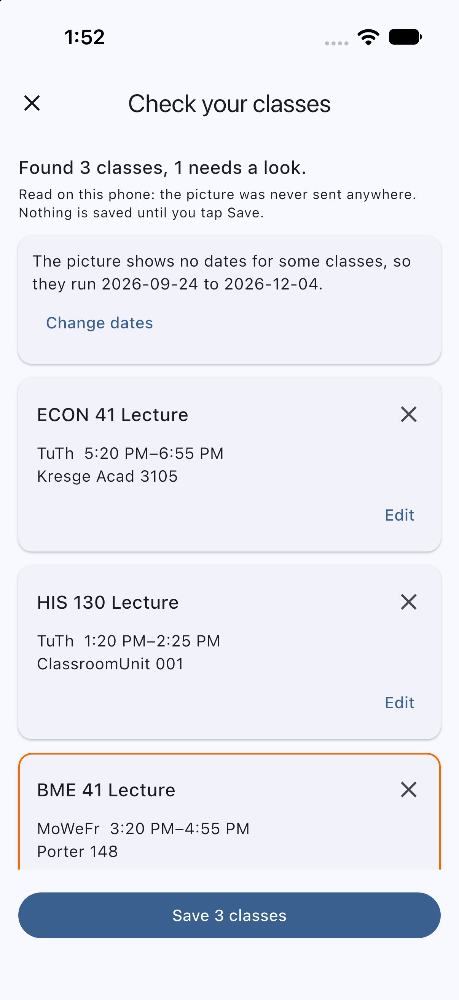
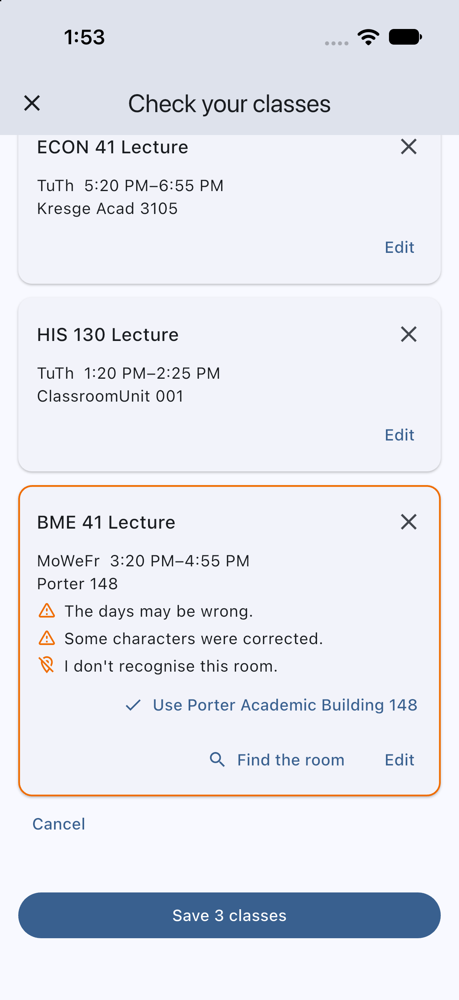

# Reading a schedule from a picture

On iOS, **Read a photo** on the Schedule tab takes a screenshot or photo of your schedule (the MyUCSC Class Schedule page, or a phone calendar or timetable app). The phone reads it itself with Apple's Vision text recognition, and Dart code in the app turns the text into classes. It is free and needs no account or key, and the reading itself works offline. The picture never leaves the phone; afterwards only the room names it found are sent to the server, to check that it can place them, as it does for any class. (Without the server you can still choose the dates and save what was read.)

| Check your classes | A class to look at |
|---|---|
|  |  |

Nothing is saved until you tap Save on the **Check your classes** screen:

- Each class can be edited (course, type, days, times, room, dates) or removed, with Undo. Cancel throws the whole import away.
- A class the reading was not sure of is outlined and says why (`The days may be wrong`, `AM or PM was guessed`). A class that cannot be saved yet, such as one with no times, is outlined in red and Save waits.
- A room the server cannot place is marked. The room search's best match is one tap away (`Use Porter Academic Building 148`), and `Find the room` opens the full search.
- A picture that shows no dates (the card layouts tried here showed none) takes the term's dates from the server, or you choose them.

**How well it works.** Invented schedules were drawn in six layouts (MyUCSC's page at several sizes, phone-style cards in light and dark, a compact table, an export with a row for each day, cards with everything on one line, and cards that label each field), read through the app in the iOS Simulator with the real Vision framework and a local server, and the review screen was compared with what each picture says. A class counts as right only if its course, days, start, end and room text all match. Each set was 23 pictures that had not been read before:

| Layout | Set 1, before any fix | Set 2, after set 1's fixes | Set 3, final code |
|---|---|---|---|
| MyUCSC Class Schedule page | 20 of 26 | 18 of 30 | 28 of 28 |
| Phone cards | 16 of 16 | 16 of 16 | 16 of 16 |
| Compact table | 34 of 36 | 29 of 31 | 37 of 37 |
| One row for each day | 20 of 23 | 20 of 21 | 20 of 20 |
| Days, times and room on one line | 29 of 30 | 27 of 29 | 29 of 29 |
| Cards that label each field | 12 of 12 | 12 of 12 | 11 of 12 |
| **All** | **131 of 143 (92%)** | **122 of 139 (88%)** | **141 of 142 (99%)** |

Set 1's mistakes led to the first repairs and set 2's to the rest; set 3 was read once, on the final code. Every wrong class was marked for review except two in set 1, where a course number read with a letter O split one class in two. The mistakes were mostly letters misread in room names (`Clrm` read as `CIrm`), an end time the phone did not read, and table headings it misread. In set 3, 24 of the 141 right classes were marked anyway, 17 of them because the server's schedule reader did not know the way the picture wrote a room (`BE 156` where it expects `J Baskin Engr 156`); the room search finds those.

These are invented pictures in fonts and layouts the project chose, so they flatter real use: they say nothing about glare, a tilted photo of a screen, heavy compression, another app's layout or any language but English. It has not been tried on a real device, a real photo or a real schedule, and the system photo picker, a photo kept only in iCloud and a HEIC photo from the camera were not exercised. The pictures and the scripts that drew and scored them are not in the repository; the readings recorded from 22 pictures like them are, in `app/test/fixtures/ocr`, and run in CI. Reading takes about a second in the Simulator on a Mac. Android has no reader yet, so the button is not shown there.

A picture that cannot be read says so and adds nothing: one with no text, text that is not a schedule, a blurry picture, or one over 120 megapixels. A very large picture is shrunk before it is read, and a table cut off part way down gives the rows that are there; each of these was tried in the Simulator.
